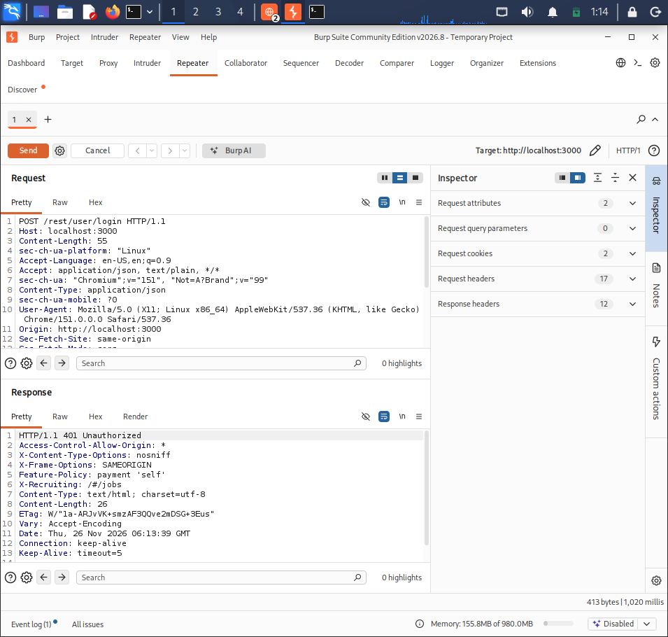
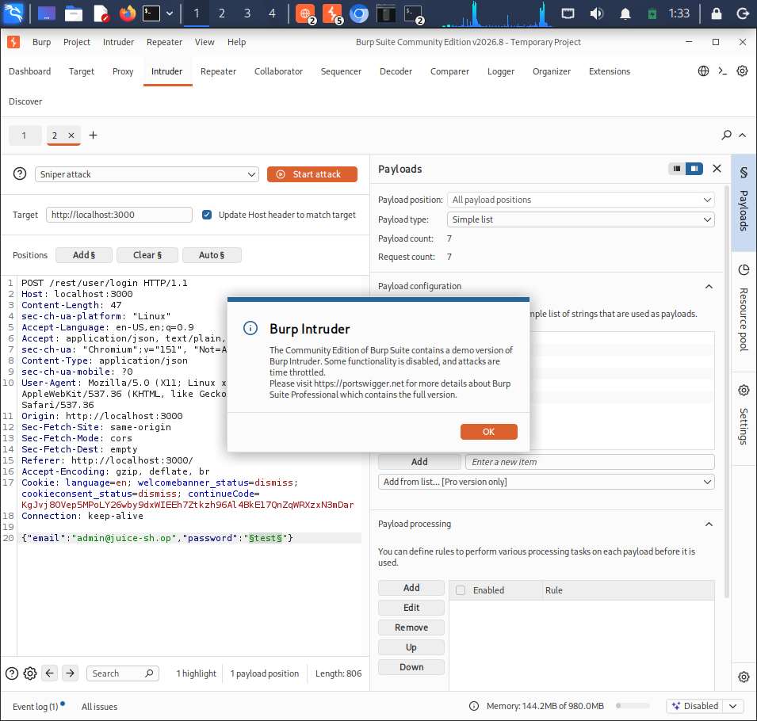

# Burp Suite Community — Practice Notes & Write-up

**Target:** OWASP Juice Shop (localhost:3000) in my own Docker lab
**Date:** 26 Nov 2026
**Full vulnerability findings:** [Juice Shop write-up](../juice-shop/)

## Setup
1. Started Burp → Temporary project → Use Burp defaults
2. Proxy → **Open browser** (built-in Chromium, already routed through Burp)
3. Browsed to `http://localhost:3000` and confirmed traffic in **Proxy → HTTP history**

## Tools I used
| Tool | What it does | How I used it |
|------|--------------|---------------|
| Proxy / HTTP history | Records every request the browser sends | Found `POST /rest/user/login`, `GET /rest/basket/1`, `POST /api/Feedbacks` |
| Intercept | Pauses a request so it can be edited before reaching the server | Changed `"rating":3` to `"rating":0` → Zero Stars challenge |
| Repeater | Edit and resend a request, compare responses | Changed basket ID `1` → `2` → IDOR; tested SQLi payloads on login |
| Decoder | Encode/decode Base64, URL, hex | Decoded the JWT payload → found the admin's MD5 password hash |
| Intruder | Automated payload attacks | Set up a Sniper attack on the login password; blocked in Community edition, so I reproduced it with a bash/curl loop |

## Screenshots

## Problems I hit and how I fixed them
- **Browser froze after turning on Intercept:** Juice Shop's background `socket.io`
  requests filled the Intercept queue. Fix: Proxy settings → Request interception
  rules → URL *does not match* `socket\.io`.
- **Repeater returned `304 Not Modified` with no body:** removed the
  `If-None-Match` header so the server sent the full response.
- **Intruder attacks disabled in Community edition:** wrote a bash/curl loop
  instead (see [`bruteforce.sh`](../juice-shop/bruteforce.sh)).

## Shortcuts
- `Ctrl+R` — send to Repeater
- `Ctrl+I` — send to Intruder
- `Ctrl+Space` — send request in Repeater

## What I learned
- Burp sits between the browser and the server, so every request can be
  read, paused, changed and replayed.
- Anything the browser enforces (form limits, hidden fields, IDs in URLs)
  can be changed in transit — the server has to check everything itself.
