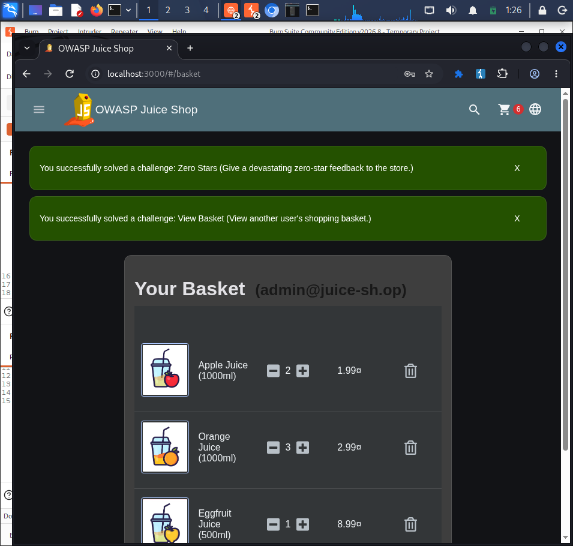
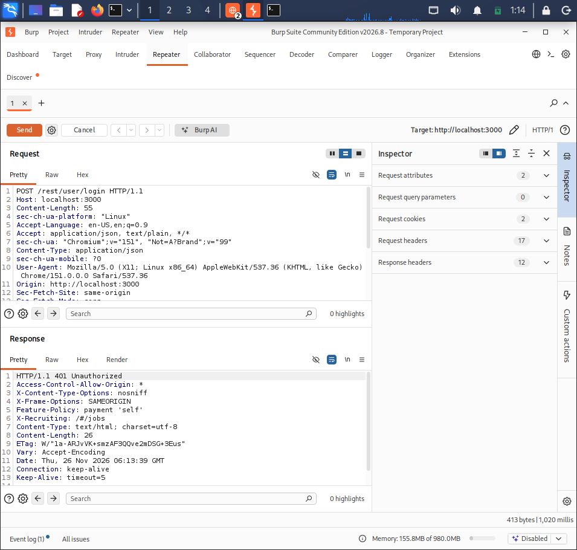
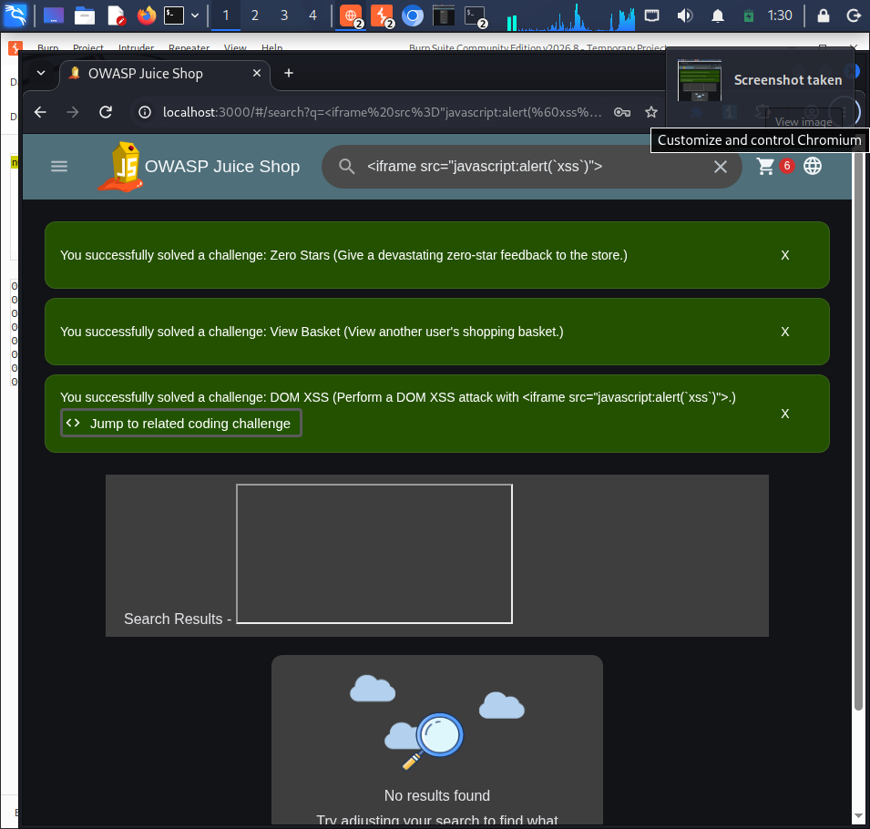

## 2. IDOR — View Another User's Basket

**Where:** `GET /rest/basket/{id}`

**Steps:**
1. Logged in as admin and opened "Your Basket" — the app requested `GET /rest/basket/1`.
2. Sent the request to Burp Repeater.
3. Changed the ID from `1` to `2` (and removed the `If-None-Match` header) and sent it.
4. The server returned another user's basket contents.

**Why it works:** the server trusts the basket ID in the URL and never checks
whether that basket belongs to the logged-in user. The JWT even contains
my real basket ID (`"bid":1`), but the server doesn't compare it.

**Impact:** any logged-in user can read every other user's basket by changing
a number — a privacy breach that scales to all users.

**Fix:** enforce object-level authorisation on the server: look up the basket
by the user ID from the verified session/token, not from the URL.



---

## 3. Password Hash Exposed in JWT

**Where:** `Authorization: Bearer` token sent with every request

**Steps:**
1. Copied the JWT from a captured request in Burp.
2. Decoded the middle (payload) section as Base64 in Burp Decoder.
3. The payload contained the admin's email, role, and
   `"password":"0192023a7bbd73250516f069df18b500"`.
4. Verified it: `echo -n 'admin123' | md5sum` produced the same hash.

**Why it's a problem:** a JWT payload is only Base64-encoded, not encrypted —
anyone holding the token can read it. The hash is unsalted MD5, which is
fast to compute, so common passwords are cracked instantly with lookup tables.
The payload also showed `"totpSecret":""` — the admin has no 2FA.

**Impact:** anyone who steals or intercepts a token learns the user's password.

**Fix:** never put passwords or hashes in tokens — include only a user ID and
role. Store passwords with a slow, salted algorithm (bcrypt or Argon2).
Enforce 2FA for admin accounts.



---

## 4. Weak Admin Password + No Rate Limiting

**Where:** `POST /rest/user/login`

**Steps:**
1. Captured a failed login for `admin@juice-sh.op` in Burp.
2. Burp Community's Intruder was blocked, so I automated the attack
   with a bash + curl loop (`bruteforce.sh`) trying common passwords.
3. Wrong passwords returned HTTP 401; `admin123` returned HTTP 200.
4. Logged in with `admin@juice-sh.op` / `admin123`.

```bash
for p in password 123456 admin admin123 letmein qwerty; do
  code=$(curl -s -o /dev/null -w "%{http_code}" -X POST http://localhost:3000/rest/user/login \
    -H 'Content-Type: application/json' \
    -d "{\"email\":\"admin@juice-sh.op\",\"password\":\"$p\"}")
  echo "$p -> $code"
done
```

**Why it works:** the admin uses a very common password, and the server
allows unlimited login attempts with no lockout, delay, or CAPTCHA.

**Impact:** admin account takeover in seconds with a tiny wordlist.

**Fix:** enforce strong password rules, rate-limit and temporarily lock
accounts after repeated failures, and require MFA for admins.


---

## 5. Zero-Star Feedback — Client-Side Validation Bypass

**Where:** `POST /api/Feedbacks`

**Steps:**
1. Filled in the Customer Feedback form with a normal star rating.
2. Turned on Burp Intercept and submitted.
3. Changed `"rating":3` to `"rating":0` in the intercepted request and forwarded it.
4. The server accepted a 0-star rating the UI doesn't allow.

**Why it works:** the 1–5 rating limit exists only in the browser.
The server accepts whatever value it receives.

**Impact:** low here, but the same flaw on price, quantity, or role fields
leads to fraud or privilege escalation.

**Fix:** validate every input on the server; treat client-side checks as
convenience only, never as security.

(Lesson learned: Juice Shop's background socket.io requests filled Burp's
Intercept queue — solved by adding an interception rule to exclude socket.io.)


---

## 6. DOM XSS in Search

**Where:** search bar (rendered client-side)

**Steps:**
1. Entered `<iframe src="javascript:alert(`xss`)">` in the search box.
2. The browser executed the JavaScript and showed an alert popup.

**Why it works:** the search term is inserted into the page as HTML
instead of plain text, so the browser runs it as code.

**Impact:** an attacker can send a victim a crafted link that runs
JavaScript in their session — stealing data, performing actions as them,
or showing fake login forms.

**Fix:** insert user input as text (e.g. `textContent`, or the framework's
default escaping) instead of raw HTML, sanitise where HTML is required,
and add a Content Security Policy.



---

## Key takeaways
 I solved all 5 challenges for the first time and using burp suite , the repeater, intruder pages, chnaging login credentials, retrieving passwords were fun!!
